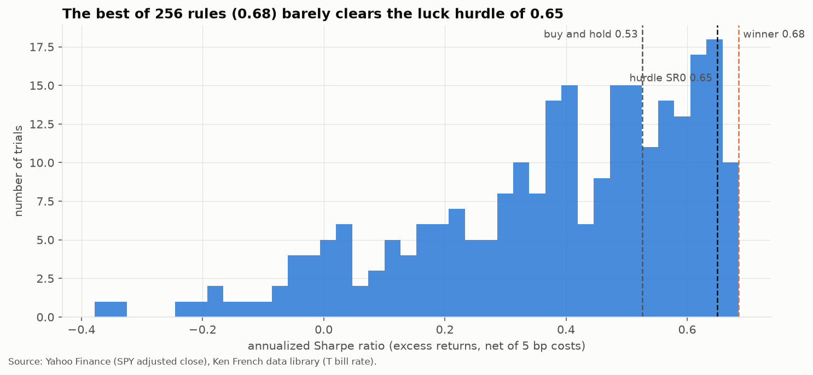

# quant_finance

Quant research projects based on academic papers, built on a tested backtesting and validation engine.



The core is `quantlab`, a small Python package that runs backtests without look ahead bias and then acts as a referee: how much of a backtest survives once you count how many variants were tried? In the first project, the best of 256 trend timing rules on SPY shows a Sharpe ratio of 0.68 against 0.53 for buy and hold (1994 to 2026, net of 5 bp costs), but the best of 256 useless rules would be expected to reach 0.65. Its deflated Sharpe ratio is 0.58, and the referee's verdict is: not distinguishable from luck.

## Installation

Requires Python 3.11 or newer (developed on 3.12).

```bash
git clone https://github.com/FranzTriebe/quant_finance.git
cd quant_finance
python3 -m venv .venv && source .venv/bin/activate
pip install -r requirements.txt
```

This also installs `quantlab` in editable mode, so `import quantlab` works from any notebook.

## Usage

Run the notebooks of Project 1 in order, in VS Code (select the `.venv` interpreter) or in Jupyter Lab (`jupyter lab`). Each one runs top to bottom on its own; the first downloads SPY and the risk free rate and caches them in `data/`.

| Notebook | What it does |
| --- | --- |
| [01_spy_buy_and_hold](projects/p01_referee/01_spy_buy_and_hold.ipynb) | checks the engine against known SPY facts (19% volatility, 55% drawdown) |
| [02_monte_carlo](projects/p01_referee/02_monte_carlo.ipynb) | shows why the best of N backtests lies, and calibrates PBO |
| [03_trials](projects/p01_referee/03_trials.ipynb) | runs 256 trend timing rules and ranks them, before the referee |
| [04_referee](projects/p01_referee/04_referee.ipynb) | the verdict: DSR, haircut Sharpe, PBO, holdout and robustness; writes `output/p01/report.md` |
| [05_my_rules](projects/p01_referee/05_my_rules.ipynb) | runs your own rule ideas through the referee and counts them in the trial ledger |

Any set of trial weights can be judged in one call:

```python
from quantlab import pipeline
run = pipeline.run_referee(trials, returns, project="p01", data_label="SPY", rf=rf)
print(run["report"]["verdict"])
```

Run the tests (offline, about 7 seconds):

```bash
pytest -q
```

## Projects

| Project | Status | Question |
| --- | --- | --- |
| [P1: Backtest referee](PLAN.md) | Phases 0 to 5 done; Phase 6 (written brief) open | I tried N variants of a strategy and kept the best one. How much of its backtest should I believe? |
| P2: Regime switching with statistical jump models | planned | Does cutting exposure in detected bear regimes help on the S&P 500, DAX and SMI? |
| P3: Trend following and CTA replication | planned | How well do trend factors at different speeds explain a managed futures fund? |
| P4: Swiss franc hedging | planned | How much currency risk should a CHF investor hedge? |
| P5: Technology momentum from patent data | planned | Do technologically linked firms predict each other's returns? |

Earlier exercises, kept as standalone notebooks:

* [momentum_strategy](projects/momentum_strategy/): 9/21 day moving average crossover on gold (GLD) against buy and hold.
* [black_scholes](projects/black_scholes/): European option pricing with Black Scholes (unfinished).

## Results

Project 1, SPY daily from April 1994 to October 2026, one day lag, 5 bp costs, excess returns over the one month T bill. Reproduce with notebook 04.

| | Sharpe | Max drawdown | DSR | Verdict |
| --- | --- | --- | --- | --- |
| Buy and hold | 0.53 | 55% | | benchmark |
| Best of 256 trend rules (`x50_250_lf_vt_w`) | 0.68 | 20% | 0.58 | not distinguishable from luck |
| Holdout: picked on 1994 to 2015, tested after | 0.65 | | | buy and hold earned 0.75 |

Slow, long/flat trend rules reliably beat the rest of the family (PBO 0.10) and cut deep drawdowns, but they earn less than buy and hold, and the specific winner is not distinguishable from luck. The verdict depends on how many independent trials the 256 represent; that choice was fixed before the run.

## Project structure

```text
├── quantlab/          # the engine: data, risk, backtest, stats, validation, strategies, pipeline, plotting
├── projects/          # one folder per project, notebooks numbered in order
├── tests/             # pytest suite, runs offline on simulated data
├── docs/figures/      # figures used in this README
├── data/              # cached downloads (not committed)
├── output/            # figures, reports, trial ledger (not committed)
├── .claude/skills/    # house rules for commits, notebooks and READMEs
├── CLAUDE.md          # working rules for Claude Code in this repo
└── PLAN.md            # build plan for Project 1
```

## Contributing

This is a personal research repo. Commits follow Conventional Commits.
